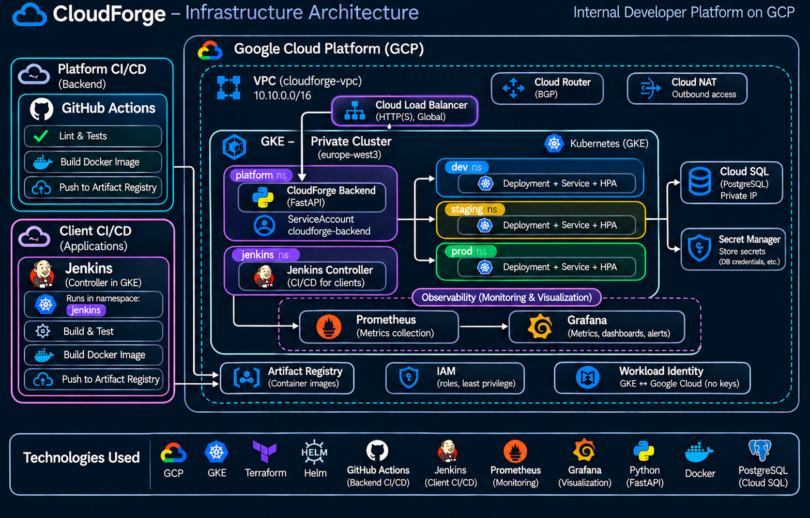

# CloudForge


### Self-Service Kubernetes Deployment Platform | Google Cloud

CloudForge is a Kubernetes-based **Internal Developer Platform (IDP)** that automates building, deploying, promoting, rolling back, and scaling containerized applications.

Developers register an application once and manage its lifecycle through a REST API without manually interacting with Kubernetes or building Docker images.

Built with **GKE, Terraform, FastAPI, PostgreSQL, Jenkins, GitHub Actions, Docker, Trivy, Helm, and Google Artifact Registry**.

**Status:** Core application CI/CD and deployment workflows are implemented and tested on GKE.

---

## Key Features

- **Self-Service Deployment:** Register applications and manage deployments through REST APIs.
- **Automated CI/CD:** Trigger Jenkins pipelines directly from CloudForge.
- **Dynamic Jenkins Agents:** Run builds in ephemeral Kubernetes Pods.
- **Container Security:** Scan Docker images using Trivy.
- **Build Management:** Track Jenkins results through authenticated callbacks and build history.
- **Automatic Deployment:** Deploy successful builds into DEV.
- **Environment Promotion:** Promote DEV → STAGING → PROD without rebuilding images.
- **Rollback:** Restore previously deployed container versions.
- **Rolling Updates:** Update applications using Kubernetes Deployment strategies.
- **Autoscaling:** Configure CPU-based Horizontal Pod Autoscalers.
- **Kubernetes Events:** Retrieve application-related Deployment and Pod events.
- **Infrastructure as Code:** Provision GCP infrastructure using Terraform.

---

## Technology Stack

| Component | Technology |
|---|---|
| Cloud Infrastructure | Google Cloud Platform, Terraform |
| Container Orchestration | GKE, Kubernetes |
| Backend | Python, FastAPI, SQLAlchemy |
| Database | Cloud SQL PostgreSQL |
| Platform CI/CD | GitHub Actions |
| Application CI/CD | Jenkins, JCasC, Job DSL |
| Container Builds | Docker, BuildKit |
| Security Scanning | Trivy |
| Container Registry | Google Artifact Registry |
| Deployment | Helm |
| Authentication | Workload Identity Federation, GKE Workload Identity |
| Authorization | Google Cloud IAM, Kubernetes RBAC |
| Secrets | Secret Manager, Secrets Store CSI |
| Networking | VPC, Cloud NAT, Cloud Router, Private Service Access |
| Traffic Routing | GKE Ingress, Google Cloud Load Balancing |
| Autoscaling | Kubernetes HPA |
| Monitoring (Planned) | Prometheus, Grafana |

---

## System Architecture

```text
                       Developer
                           |
                           v
                Google Cloud Load Balancer
                           |
                           v
                       GKE Ingress
                           |
                           v
                  CloudForge Service
                           |
                           v
                  FastAPI Backend
                 Namespace: platform
                           |
          +----------------+----------------+
          |                |                |
          v                v                v
      Cloud SQL       Kubernetes API     Jenkins
      PostgreSQL            |          Controller
          |                 |               |
          |                 |               v
          |                 |        Ephemeral Agent
          |                 |               |
          |                 |         Git Checkout
          |                 |               |
          |                 |         Docker Build
          |                 |               |
          |                 |         Trivy Scan
          |                 |               |
          |                 |        Artifact Registry
          |                 |               |
          |                 |        Build Callback
          |                 |               |
          +-----------------+---------------+
                            |
                            v
                       DEV Deployment
                            |
                         Promote
                            v
                     STAGING Deployment
                            |
                         Promote
                            v
                       PROD Deployment
```

The architecture uses a GKE Ingress manifest to configure Google Cloud Load Balancing. External availability requires successful Ingress provisioning and healthy backends.

---

## Cloud Infrastructure

Terraform provisions the infrastructure in **GCP `europe-west3`**.

### Networking

- Custom VPC and subnet with secondary Pod and Service ranges.
- Cloud Router and Cloud NAT for private-node outbound connectivity.
- Private Service Access for Cloud SQL connectivity.
- Private GKE worker nodes.
- GKE Ingress for external traffic routing.

### Kubernetes Namespaces

| Namespace | Purpose |
|---|---|
| `platform` | CloudForge FastAPI backend |
| `jenkins` | Jenkins Controller and ephemeral agents |
| `dev` | Development applications |
| `staging` | Staging applications |
| `prod` | Production applications |

### Security

- Workload Identity Federation for GitHub Actions.
- GKE Workload Identity for backend access to GCP.
- Namespace-scoped Kubernetes RBAC.
- Secret Manager and Secrets Store CSI.
- Private IP connectivity to Cloud SQL.
- Scoped IAM roles and dedicated service accounts.

---

## CI/CD Architecture

CloudForge separates platform delivery from application delivery.

### 1. Platform CI/CD — GitHub Actions

GitHub Actions builds and deploys the CloudForge backend.

```text
GitHub Push
     |
     v
GitHub Actions
     |
     v
GCP Authentication (OIDC)
     |
     v
Build Backend Image
     |
     v
Push to Artifact Registry
     |
     v
Helm Upgrade
     |
     v
CloudForge Backend on GKE
```

### 2. Application CI/CD — Jenkins

Jenkins runs inside GKE with JCasC, Job DSL, and ephemeral Kubernetes agents.

```text
CloudForge API
     |
     v
Jenkins Pipeline
     |
     +-- Git Checkout (main)
     +-- Dockerfile Validation
     +-- Docker Image Build
     +-- Trivy Vulnerability Scan
     +-- Push to Artifact Registry
     |
     v
Authenticated Build Callback
     |
     v
CloudForge PostgreSQL
     |
     v
Automatic Deployment to DEV
```

Jenkins sends build results using a `post { always { ... } }` block. Successful builds trigger automatic deployment; failed builds are recorded without deployment.

### Important: Jenkins Repository Requirements

**The current Jenkins pipeline builds applications exclusively from the `main` branch.**

Requirements:

1. The Git repository must contain a `main` branch.
2. The application source and `Dockerfile` must be committed to `main`.
3. The `Dockerfile` must be located in the repository root.
4. Jenkins must have access to the repository.
5. The application must listen on port `8000` and expose `/health`.

Example:

```text
my-application/
├── Dockerfile
├── app.py
├── requirements.txt
└── README.md
```

```bash
git checkout main
git add .
git commit -m "Prepare application for CloudForge"
git push origin main
```

Other branches, including `develop` and `feature/*`, are not currently supported. Jenkins builds images from source code; prebuilt images are not required.

---

## Application Lifecycle

### 1. Register Application

`POST /applications/`

Creates an Application record and DEV, STAGING, and PROD environment records in PostgreSQL.

### 2. Trigger Build

`POST /applications/{application_id}/build`

CloudForge queues a Jenkins pipeline and records the initial `QUEUED` status.

### 3. Build and Callback

Jenkins builds, scans, and pushes the image to Artifact Registry.

The authenticated callback updates the Build record with `SUCCESS` or `FAILURE` and the resulting image URI.

### 4. Automatic Deployment

Successful builds automatically deploy to DEV using the Kubernetes API.

Deployments include Services, resource requests/limits, and liveness/readiness probes.

### 5. Promotion and Rollback

- Promote DEV → STAGING → PROD using existing images.
- Roll back to the previous successful image.
- Use Kubernetes rolling updates for image changes.

### 6. Autoscaling

CloudForge creates or updates Kubernetes HPAs with configurable minimum replicas, maximum replicas, and target CPU utilization.

### Image Versioning

```text
app-{application_id}:{jenkins_build_number}

app-23:16
app-23:17
app-23:18
```

The Application ID remains unchanged across builds. The image tag identifies the Jenkins build.

---

## API Reference

| Method | Endpoint | Description |
|---|---|---|
| POST | `/applications/` | Register application |
| POST | `/applications/{id}/build` | Trigger Jenkins build |
| POST | `/applications/builds/{build_id}/callback` | Receive Jenkins result |
| GET | `/applications/{id}/builds` | Retrieve build history |
| POST | `/applications/{id}/deploy` | Deploy to DEV |
| POST | `/applications/{id}/promote` | Promote application |
| POST | `/applications/{id}/rollback` | Restore previous version |
| PATCH | `/applications/{id}/scaling` | Configure HPA |

Interactive API documentation is available at `/docs`.

---

## Quick Start

CloudForge runs on GCP/GKE. These steps deploy and access it from a local computer, not an offline local cluster.

### Prerequisites

Git, Google Cloud CLI, Terraform, kubectl, Helm, a billing-enabled GCP project, and appropriate IAM permissions.

**Note:** GKE, Cloud SQL, Cloud NAT, and Load Balancing may incur charges.

### 1. Clone and Authenticate

```bash
git clone https://github.com/Msrt12/cloudforge.git
cd cloudforge

gcloud auth login
gcloud auth application-default login
gcloud config set project YOUR_PROJECT_ID
```

### 2. Provision Infrastructure

Review the Terraform variables and required GCP permissions before applying.

```bash
cd terraform
terraform init
terraform validate
terraform plan
terraform apply
cd ..
```

### 3. Connect to GKE

```bash
gcloud container clusters get-credentials CLUSTER_NAME \
  --region CLUSTER_REGION \
  --project YOUR_PROJECT_ID

kubectl get nodes
```

Use `--zone` instead of `--region` for a zonal cluster.

### 4. Configure Platform Dependencies

Verify Cloud SQL connectivity, Workload Identity, Secret Manager access, Kubernetes RBAC, Artifact Registry permissions, and Jenkins callback credentials.

The Jenkins callback credential ID is `cloudforge-callback-token`.

### 5. Deploy CloudForge

Ensure the backend image and required Helm values are configured.

```bash
helm upgrade --install cloudforge ./helm/cloudforge \
  --namespace platform --create-namespace

kubectl get pods -n platform
kubectl get ingress -n platform
```

### 6. Deploy Jenkins

Review `helm/jenkins/values.yaml` and required credentials.

```bash
helm repo add jenkins https://charts.jenkins.io
helm repo update

helm upgrade --install jenkins jenkins/jenkins \
  --namespace jenkins --create-namespace \
  -f helm/jenkins/values.yaml
```

### 7. Access the Services

```bash
kubectl port-forward svc/cloudforge-backend 8080:80 -n platform
```

CloudForge Swagger: `http://localhost:8080/docs`

In a separate terminal:

```bash
kubectl port-forward svc/jenkins 8082:8080 -n jenkins
```

Jenkins: `http://localhost:8082`

Confirm actual Service names using `kubectl get svc -n platform` and `kubectl get svc -n jenkins`.

### 8. Build and Deploy an Application

1. Prepare a Git repository with a root-level Dockerfile on `main`.
2. Register it using `POST /applications/`.
3. Trigger Jenkins using `POST /applications/{id}/build`.
4. Check the result using `GET /applications/{id}/builds`.
5. Verify the automatic DEV deployment.

```bash
kubectl get deployments -n dev
kubectl get pods -n dev
kubectl get hpa -n dev
```

For promotion, rollback, and autoscaling, use the corresponding Swagger endpoints.

---

## Troubleshooting

| Problem | What to Check |
|---|---|
| Build stuck in QUEUED | Jenkins queue, agent scheduling, callback delivery |
| ImagePullBackOff | Image URI, Artifact Registry access |
| CrashLoopBackOff | Container logs, entrypoint, dependencies |
| Readiness failure | `/health`, port `8000`, probe configuration |
| HPA not scaling | Metrics Server, CPU requests, HPA events |
| Ingress unavailable | External IP, Service, NEG, backend health |
| Terraform permission errors | ADC identity, project, IAM roles |

Useful commands:

```bash
kubectl describe pod POD_NAME -n dev
kubectl logs POD_NAME -n dev
kubectl get events -n dev --sort-by=.lastTimestamp
kubectl describe ingress cloudforge-ingress -n platform
```

---

## Roadmap

### Implemented

- [x] Terraform-based GCP infrastructure
- [x] Private-node GKE cluster and Cloud SQL
- [x] Secret Manager and Workload Identity
- [x] Kubernetes RBAC and Helm deployment
- [x] GitHub Actions platform CI/CD
- [x] Jenkins JCasC, Job DSL, and dynamic agents
- [x] Docker image builds and Trivy scanning
- [x] Artifact Registry image publishing
- [x] Jenkins API triggering and authenticated callbacks
- [x] Build history and status persistence
- [x] Automatic DEV deployment
- [x] Environment promotion and rollback
- [x] Rolling Updates and HPA
- [x] Kubernetes event retrieval
- [x] GKE Ingress manifest

### Planned / Further Verification

- [ ] Verify external Load Balancer provisioning and backend health
- [ ] HTTPS and external API authentication
- [ ] Jenkins callback retries and detailed failure reporting
- [ ] Automated rollout readiness tracking
- [ ] Prometheus and Grafana
- [ ] Monitoring and alerting
- [ ] Automated integration tests

---

## Repository Structure

```text
cloudforge/
├── .github/workflows/
├── backend/
│   ├── app/
│   │   ├── routers/
│   │   ├── models.py
│   │   ├── schemas.py
│   │   └── main.py
│   ├── Dockerfile
│   └── requirements.txt
├── helm/
│   ├── cloudforge/
│   │   └── templates/
│   │       ├── deployment.yaml
│   │       ├── service.yaml
│   │       ├── ingress.yaml
│   │       └── rbac.yaml
│   └── jenkins/
│       └── values.yaml
├── terraform/
└── README.md
```

---

## Author

**Mykola Dmytrash**

[Portfolio](https://msrt12.github.io/portfolio/) · [GitHub](https://github.com/Msrt12)

**CloudForge — Self-service application delivery on Kubernetes.**
